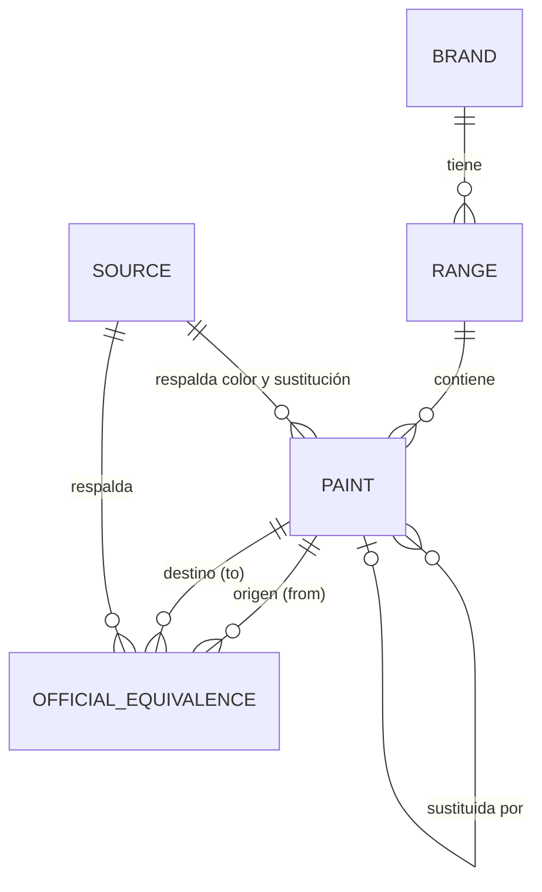

# Modelo de dominio: catálogo de pinturas

> Fase 1. Especifica el modelo del catálogo. Las armonías y la rueda se tratan en la fase 4.

## 1. Convenciones

| Dominio (es)         | Código (en)           |
| -------------------- | --------------------- |
| Marca                | `Brand`               |
| Gama                 | `Range`               |
| Pintura              | `Paint`               |
| Tipo                 | `PaintType`           |
| Estado               | `PaintStatus`         |
| Sustituta            | `Replacement`         |
| Equivalencia oficial | `OfficialEquivalence` |
| Fuente               | `Source`              |
| Catálogo             | `Catalog`             |

- **Idiomas**: el código va en inglés y la documentación en castellano.
- **Inmutabilidad**: todas las entidades son `readonly` y el catálogo es de solo lectura en el cliente.
- **Identificadores nominales** (_branded types_): un `PaintId` no se acepta donde se espera un `RangeId`, aunque ambos sean `string`. El formato está en [03-identificadores.md](03-identificadores.md).
- **Ausencia de valor**: en las entidades persistidas se usa `null` explícito, nunca un campo opcional (`?`). Así el JSON y el tipo tienen la misma forma y solo hay una manera de expresar "sin dato".
- **Datos y comportamiento separados**: las entidades son solo datos. El comportamiento vive en funciones del dominio y en el agregado `Catalog`.
- **Fuente de verdad de los tipos**: en el código se infieren del esquema Zod ([ADR-0002](adr/0002-validacion-catalogo-zod.md)). Este documento es la especificación que ese esquema debe cumplir. Los tipos exactos, con sus campos, están en la referencia de la API, que se genera desde el código con `pnpm docs:api` ([README](../README.md#comandos)).

## 2. Relaciones

## 3. Entidades

### Fuente (`Source`)

Cualquier dato que no sea trivial (un color, una sustitución, una equivalencia) cita una fuente. Las fuentes se guardan como entidad propia para no repetir URLs y para poder auditar de dónde sale cada dato.

`kind` indica **quién es el autor** del contenido: `manufacturer` es la propia marca y `third-party` cualquier otro. Una copia fiel de un documento del fabricante alojada por un tercero sigue siendo `manufacturer`.

Cada fuente guarda su URL oficial (`url`, o `null` en las fuentes impresas), una captura de la Wayback Machine (`archiveUrl`), su licencia (`license`) y el texto de atribución (`attribution`). La interfaz muestra las licencias y las atribuciones en la página «Créditos y fuentes», no en la rueda ni en las fichas ([ADR-0015](adr/0015-fuentes-trazabilidad-licencias.md)). No hay que confundirlo con el origen del color (`ColorOrigin`), que indica **cómo se obtuvo** el valor.

### Marca (`Brand`) y gama (`Range`)

Una gama es una línea comercial tal como la vende el fabricante ([ADR-0013](adr/0013-clasificacion-pinturas.md)). En Citadel hay una gama por línea (Base, Layer, Shade…), y las líneas antiguas (Citadel Colour, Foundation…) son gamas descatalogadas.

`aliases` guarda los nombres anteriores de la marca y sirve para la búsqueda. Por ejemplo, la marca `citadel` se llama «Warhammer Colour» y tiene como alias «Citadel».

### Pintura (`Paint`)

- `type` es la **función** de la pintura, según la clasificación del fabricante: base, capa, estándar (opaca, de una marca que no distingue entre base y capa), lavado, tinta, veladura, contrast (una sola capa, de cualquier marca), técnica o pincel seco.
- `metallic` es el **acabado**, y es independiente de la función ([ADR-0013](adr/0013-clasificacion-pinturas.md)).
- Los productos sin color (mediums, barnices, diluyentes) no forman parte del catálogo.
- `manufacturerCode` es un atributo de la pintura, no su identidad. Solo se rellena si consta en una fuente.
- `aliases` contiene nombres anteriores o alternativos y sirve para la búsqueda.

### Color (`PaintColor`)

Cada color guarda tres cosas: el hex sRGB, su origen y la fuente. Los orígenes son:

- `measured`: medición con un instrumento sobre una muestra pintada.
- `manufacturer`: hex publicado por el fabricante.
- `community`: cualquier otro, incluidos los hex sacados de fotos y por scraping.

Cada pintura tiene un único color, que se fija al importar sus datos ([04-datos-curados.md](04-datos-curados.md)). Elegir entre varios candidatos por prioridad `measured` > `manufacturer` > `community` está aplazado ([ADR-0019](adr/0019-alcance-minimo-mvp.md)). Si ninguna fuente aporta un hex, el color es `null`: la pintura sigue apareciendo en el catálogo y en las equivalencias oficiales, pero no en la rueda ni en las equivalencias calculadas ([ADR-0014](adr/0014-origen-seleccion-color.md)).

### Estado y sustituta (`PaintStatus`, `Replacement`)

El estado es una unión discriminada. Una pintura activa no puede tener sustituta. Una descatalogada puede tenerla, siempre con una fuente del fabricante ([ADR-0005](adr/0005-sustitucion-en-estado.md)). Solo hay sustituta si la fuente dice expresamente que X sustituye a Y. Las cartas de conversión entre líneas, aunque sean del propio fabricante, generan equivalencias oficiales, no sustituciones.

### Equivalencia oficial (`OfficialEquivalence`)

Es una arista dirigida `from → to` con una fuente del fabricante obligatoria. Su dirección es la que publica la fuente, y no se infieren ni las inversas ni las transitivas ([ADR-0004](adr/0004-equivalencias-dirigidas.md)).

### Catálogo (`Catalog`)

Es el agregado de solo lectura que se construye al cargar `catalog.json` ya validado. Es el único punto de acceso a los datos desde la interfaz y oculta sus índices internos. Las consultas de pinturas indican siempre las marcas y si se incluyen las descatalogadas, sin valores por defecto ocultos.

## 4. Reglas derivadas (funciones de domain)

| Regla                              | Definición                                                                                                                                                                                                                                                                                                                          |
| ---------------------------------- | ----------------------------------------------------------------------------------------------------------------------------------------------------------------------------------------------------------------------------------------------------------------------------------------------------------------------------------- |
| `isColorApproximate(paint)`        | `true` si `color !== null` y se cumple al menos una condición: `metallic`, `type ∈ {wash, ink, glaze, contrast, technical}` o `color.origin === 'community'`.                                                                                                                                                                       |
| `colorApproximationReasons(paint)` | Las razones de que el color sea aproximado, en este orden: `metallic`, `paint-type` (el tipo es uno de los anteriores) y `community-color`. Vacío si no lo es o si la pintura no tiene color. `isColorApproximate` es que haya alguna razón.                                                                                        |
| `sourceContributions(catalog)`     | Cada fuente, en el orden del catálogo, con lo que respalda: los colores de pintura por marca y gama, y cuántas sustituciones y equivalencias oficiales. Es lo que la interfaz atribuye a cada fuente en «Créditos y fuentes» ([ADR-0015](adr/0015-fuentes-trazabilidad-licencias.md)).                                              |
| `resolveReplacement(catalog, id)`  | Sigue la cadena de sustitutas hasta llegar a una pintura activa o al final de la cadena, y devuelve esa pintura. Devuelve `null` si la pintura no tiene sustituta. Un `id` que no está en el catálogo es un error de programación y lanza una excepción. Siempre termina, porque los ciclos están prohibidos.                       |
| Equivalencias calculadas           | Se calculan con CIEDE2000 en el cliente y nunca se persisten. Excluyen las pinturas sin color. Si el origen o el destino tienen un color aproximado, el resultado lleva `approximate: true` y la interfaz lo avisa. Las etiquetas de calidad, el orden y los filtros están en [06-pinturas-parecidas.md](06-pinturas-parecidas.md). |
| Equivalencias oficiales            | Se leen solo en su dirección. No se infieren ni las inversas ni las transitivas.                                                                                                                                                                                                                                                    |

## 5. Invariantes

Se comprueban al cargar el catálogo; el detalle está en [02-esquema-catalog-json.md](02-esquema-catalog-json.md).

1. Los IDs son únicos dentro de cada colección y tienen un formato válido.
2. Toda referencia apunta a una entidad que existe.
3. Si una gama está descatalogada, todas sus pinturas lo están.
4. Una pintura no puede ser su propia sustituta y las cadenas de sustitución no tienen ciclos.
5. Las fuentes de sustituciones y de equivalencias oficiales son de tipo `manufacturer`.
6. En una equivalencia, `from ≠ to`, y la terna `(from, to, sourceId)` es única.
7. `name` no está vacío. En marcas y pinturas, `aliases` no tiene duplicados ni repite `name`.
8. Si `Source.url` es `null`, `Source.archiveUrl` también lo es.
9. Las colecciones están ordenadas como exige [02-esquema-catalog-json.md](02-esquema-catalog-json.md) §1.
