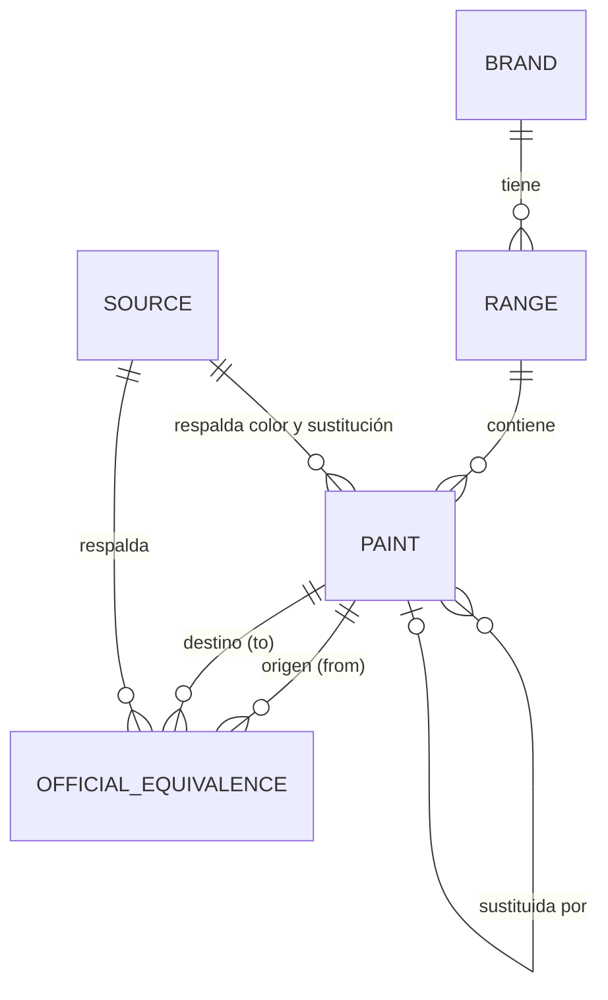

# Modelo de dominio: catálogo de pinturas

> Fase 1. Especifica el modelo del catálogo. Las armonías y la rueda se tratan en la fase 3.

## 1. Convenciones

| Dominio (es)         | Código (en)           |
| -------------------- | --------------------- |
| Marca                | `Brand`               |
| Gama                 | `Range`               |
| Pintura              | `Paint`               |
| Tipo                 | `PaintType`           |
| Estado               | `PaintStatus`         |
| Sustituta            | `Replacement`         |
| Equivalencia oficial | `OfficialEquivalence` |
| Fuente               | `Source`              |
| Catálogo             | `Catalog`             |

- **Idiomas**: el código va en inglés y la documentación en castellano.
- **Inmutabilidad**: todas las entidades son `readonly` y el catálogo es de solo lectura en el cliente.
- **Identificadores nominales** (_branded types_): un `PaintId` no se acepta donde se espera un `RangeId`, aunque ambos sean `string`. El formato está en [03-identificadores.md](03-identificadores.md).
- **Ausencia de valor**: en las entidades persistidas se usa `null` explícito, nunca un campo opcional (`?`). Así el JSON y el tipo tienen la misma forma y solo hay una manera de expresar "sin dato".
- **Datos y comportamiento separados**: las entidades son solo datos. El comportamiento vive en funciones del dominio y en el agregado `Catalog`.
- **Fuente de verdad de los tipos**: en el código se infieren del esquema Zod ([ADR-0002](adr/0002-validacion-catalogo-zod.md)). Este documento es la especificación que ese esquema debe cumplir.

## 2. Relaciones



## 3. Entidades

### Fuente (`Source`)

Cualquier dato que no sea trivial (un color, una sustitución, una equivalencia) cita una fuente. Las fuentes se guardan como entidad propia para no repetir URLs y para poder auditar de dónde sale cada dato.

`kind` indica **quién publica** la fuente: `manufacturer` es la propia marca y `third-party` cualquier otro. No hay que confundirlo con el origen del color (`ColorOrigin`), que indica **cómo se obtuvo** el valor.

### Marca (`Brand`) y gama (`Range`)

Una gama es una línea comercial tal como la vende el fabricante ([ADR-0008](adr/0008-clasificacion-pinturas.md)). La granularidad concreta, por ejemplo cómo se divide "Citadel antigua", se decide en la fase 2 a partir de las fuentes.

### Pintura (`Paint`)

- `type` es la **función** de la pintura: base, capa, lavado, contrast o técnica.
- `metallic` es el **acabado**, y es independiente de la función ([ADR-0008](adr/0008-clasificacion-pinturas.md)).
- `manufacturerCode` es un atributo de la pintura, no su identidad. Solo se rellena si consta en una fuente.
- `aliases` contiene nombres anteriores o alternativos y sirve para la búsqueda.

### Color (`PaintColor`)

Cada color guarda tres cosas: el hex sRGB, su origen (`manufacturer`, `measured` o `community`) y la fuente. Cada pintura tiene un único color. Si ninguna fuente aporta un hex, el color es `null`: la pintura sigue apareciendo en el catálogo y en las equivalencias oficiales, pero no en la rueda ni en las equivalencias calculadas ([ADR-0003](adr/0003-fiabilidad-color.md)).

### Estado y sustituta (`PaintStatus`, `Replacement`)

El estado es una unión discriminada. Una pintura activa no puede tener sustituta. Una descatalogada puede tenerla, siempre con una fuente del fabricante ([ADR-0005](adr/0005-sustitucion-en-estado.md)).

### Equivalencia oficial (`OfficialEquivalence`)

Es una arista dirigida `from → to` con una fuente del fabricante obligatoria. Su dirección es la que publica la fuente, y no se infieren ni las inversas ni las transitivas ([ADR-0004](adr/0004-equivalencias-dirigidas.md)).

### Catálogo (`Catalog`)

Es el agregado de solo lectura que se construye al cargar `catalog.json` ya validado. Es el único punto de acceso a los datos desde la interfaz y oculta sus índices internos.

## 4. Especificación TypeScript

```ts
// ── Identificadores ──────────────────────────────────────────
// El mecanismo concreto de branding lo aporta Zod; aquí se indica la intención.
type Branded<T, Name extends string> = T & { readonly __brand: Name };

type BrandId = Branded<string, "BrandId">; // "citadel"
type RangeId = Branded<string, "RangeId">; // "citadel/base"
type PaintId = Branded<string, "PaintId">; // "citadel/base/abaddon-black"
type SourceId = Branded<string, "SourceId">;
type HexColor = Branded<string, "HexColor">; // "#rrggbb", en minúsculas
type IsoDate = Branded<string, "IsoDate">; // "AAAA-MM-DD"

// ── Fuente ───────────────────────────────────────────────────
type SourceKind = "manufacturer" | "third-party";

interface Source {
  readonly id: SourceId;
  readonly kind: SourceKind;
  readonly title: string;
  readonly publisher: string;
  readonly url: string | null; // null en fuentes impresas
  readonly retrievedAt: IsoDate; // fecha de consulta
}

// ── Marca y gama ─────────────────────────────────────────────
interface Brand {
  readonly id: BrandId;
  readonly name: string;
}

type RangeStatus = "active" | "discontinued";

interface Range {
  readonly id: RangeId;
  readonly brandId: BrandId;
  readonly name: string;
  readonly status: RangeStatus;
}

// ── Pintura ──────────────────────────────────────────────────
type PaintType = "base" | "layer" | "wash" | "contrast" | "technical";

type ColorOrigin = "manufacturer" | "measured" | "community";

interface PaintColor {
  readonly hex: HexColor; // sRGB
  readonly origin: ColorOrigin;
  readonly sourceId: SourceId;
}

interface Replacement {
  readonly paintId: PaintId;
  readonly sourceId: SourceId; // siempre con kind = 'manufacturer'
}

type PaintStatus =
  | { readonly kind: "active" }
  | { readonly kind: "discontinued"; readonly replacement: Replacement | null };

interface Paint {
  readonly id: PaintId;
  readonly rangeId: RangeId;
  readonly name: string;
  readonly aliases: readonly string[];
  readonly manufacturerCode: string | null;
  readonly type: PaintType;
  readonly metallic: boolean;
  readonly color: PaintColor | null;
  readonly status: PaintStatus;
}

// ── Equivalencia oficial ─────────────────────────────────────
interface OfficialEquivalence {
  readonly from: PaintId;
  readonly to: PaintId;
  readonly sourceId: SourceId; // siempre con kind = 'manufacturer'
}

// ── Catálogo (agregado en memoria) ───────────────────────────
interface CatalogMeta {
  readonly schemaVersion: number;
  readonly dataVersion: string; // "sha256:<64 caracteres hex>"
}

interface PaintQuery {
  readonly brandIds: readonly BrandId[] | "all";
  readonly includeDiscontinued: boolean; // explícito: sin valores por defecto ocultos
}

interface Catalog {
  readonly meta: CatalogMeta;
  brands(): readonly Brand[];
  rangesOf(brandId: BrandId): readonly Range[];
  brand(id: BrandId): Brand | undefined;
  range(id: RangeId): Range | undefined;
  paint(id: PaintId): Paint | undefined;
  source(id: SourceId): Source | undefined;
  paints(query: PaintQuery): readonly Paint[];
  brandOf(paint: Paint): Brand; // no puede fallar: la integridad se valida al cargar
  officialEquivalencesFrom(id: PaintId): readonly OfficialEquivalence[];
  officialEquivalencesTo(id: PaintId): readonly OfficialEquivalence[];
}

// ── No persistido: equivalencia calculada ───────────────────
interface CalculatedMatch {
  readonly paintId: PaintId;
  readonly deltaE2000: number;
  readonly approximate: boolean; // true si cualquiera de los dos colores es aproximado
}
```

## 5. Reglas derivadas (funciones de domain)

| Regla                             | Definición                                                                                                                                                                                                                                                           |
| --------------------------------- | -------------------------------------------------------------------------------------------------------------------------------------------------------------------------------------------------------------------------------------------------------------------- |
| `isColorApproximate(paint)`       | `true` si `color !== null` y se cumple al menos una condición: `metallic`, `type ∈ {wash, contrast, technical}` o `color.origin === 'community'`.                                                                                                                    |
| `resolveReplacement(catalog, id)` | Sigue la cadena de sustitutas hasta llegar a una pintura activa o al final de la cadena. Siempre termina, porque los ciclos están prohibidos.                                                                                                                        |
| Equivalencias calculadas          | Se calculan con CIEDE2000 en el cliente y nunca se persisten. Excluyen las pinturas sin color. Si el origen o el destino tienen un color aproximado, el resultado lleva `approximate: true` y la interfaz lo avisa. Los umbrales y el orden se definen en la fase 3. |
| Equivalencias oficiales           | Se leen solo en su dirección. No se infieren ni las inversas ni las transitivas.                                                                                                                                                                                     |

## 6. Invariantes

Se comprueban al cargar el catálogo; el detalle está en [02-esquema-catalog-json.md](02-esquema-catalog-json.md).

1. Los IDs son únicos dentro de cada colección y tienen un formato válido.
2. Toda referencia apunta a una entidad que existe.
3. Si una gama está descatalogada, todas sus pinturas lo están.
4. Una pintura no puede ser su propia sustituta y las cadenas de sustitución no tienen ciclos.
5. Las fuentes de sustituciones y de equivalencias oficiales son de tipo `manufacturer`.
6. En una equivalencia, `from ≠ to`, y la terna `(from, to, sourceId)` es única.
7. `name` no está vacío. `aliases` no tiene duplicados ni repite `name`.

## 7. Puntos abiertos (fase 2)

- **Granularidad de las gamas**, sobre todo la de Citadel antigua.
- **Tipos no cubiertos**: pincel seco, aerógrafo y a qué tipo se asignan los productos de otras marcas parecidos a contrast. Añadir un valor al enum es un cambio incompatible y obliga a subir `schemaVersion`.
- **Prioridad entre orígenes de color** cuando varias fuentes dan hex distintos. El modelo solo guarda uno.
- **Tablas de equivalencias de terceros**: hoy las excluye el invariante 5. Si se incluyen, la entidad pasaría a ser una equivalencia con fuente genérica y su nivel de confianza se derivaría de `Source.kind`.
